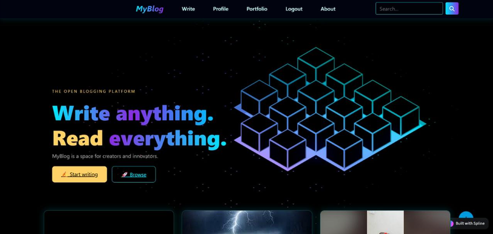
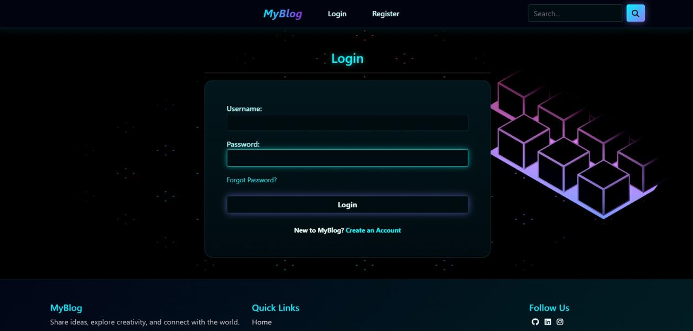
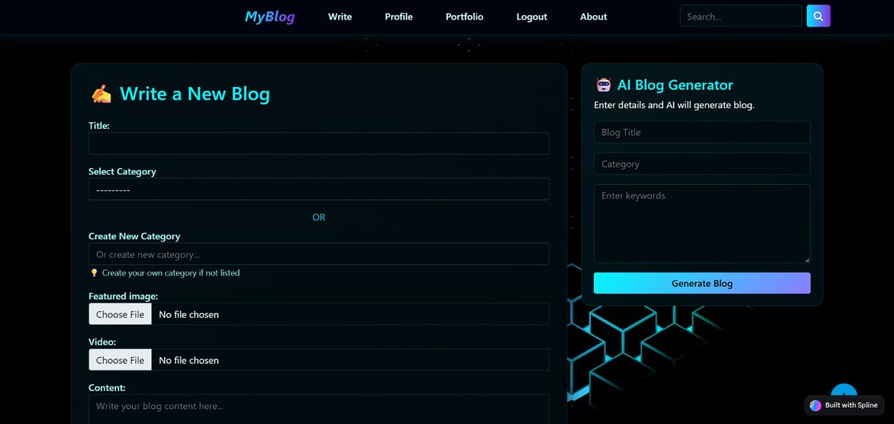
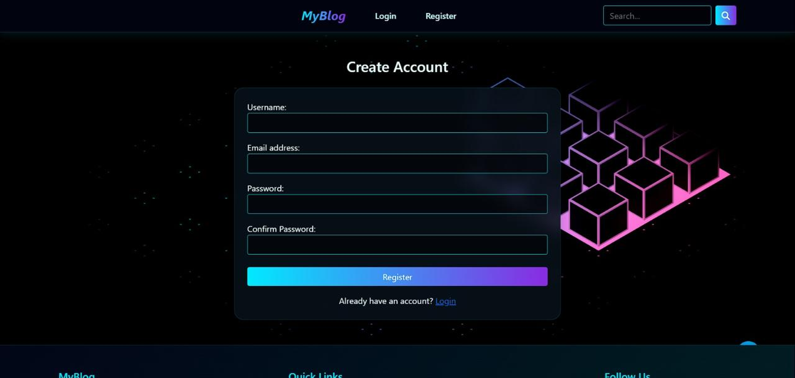
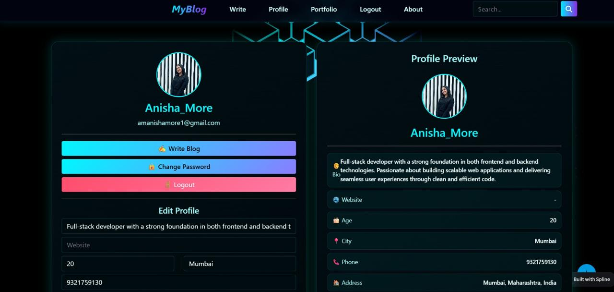
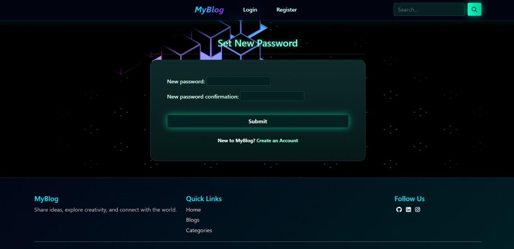
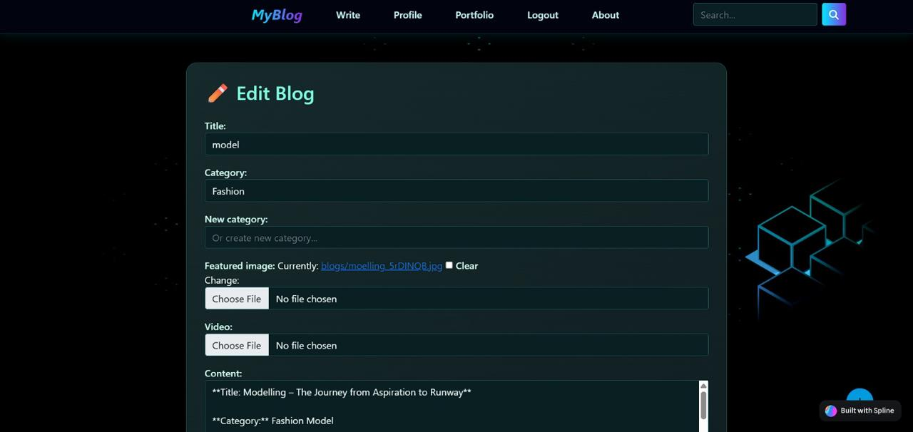
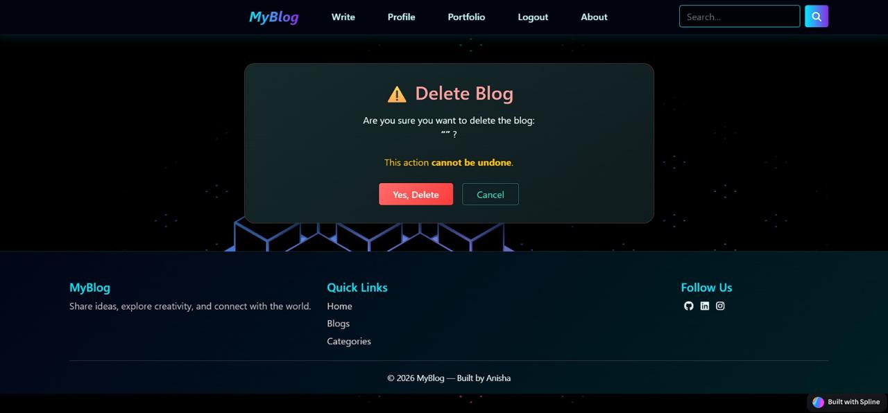
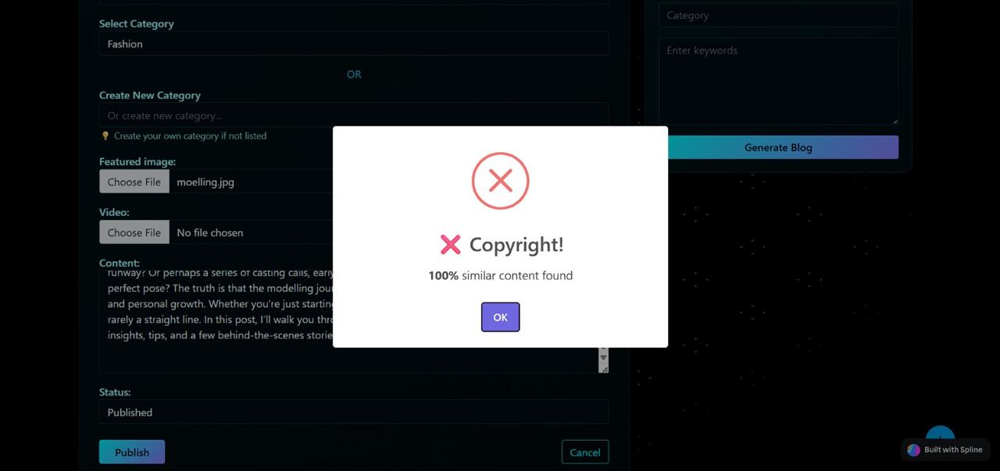

<div align="center">

# 🚀 AI Blogging Platform

### *A Modern AI-Powered Blogging Platform built with Django*


---


</div>

---

# 📖 About the Project

**AI Blogging Platform** is a full-stack web application developed using **Django** that enables users to create, edit, publish, and manage blogs through an elegant cyberpunk-inspired interface.

The platform integrates an **AI Blog Generator** to assist users in generating blog content based on keywords and categories. It also includes **copyright detection**, secure authentication, media uploads, profile management, and a responsive design.

---

# ✨ Key Features

## 🤖 AI Features

- AI Blog Generator
- Keyword-based Content Generation
- Copyright Detection
- Smart Content Assistance

---

## 📝 Blog Management

- Create Blogs
- Edit Blogs
- Delete Blogs
- Publish Blogs
- Rich Text Content
- Category Management

---

## 👤 User Management

- User Registration
- Secure Login
- Logout
- Password Reset
- Profile Management
- Profile Picture Upload

---

## 📁 Media Support

- Image Upload
- Video Upload
- Featured Blog Images

---

## 🔍 Search

- Search Blogs
- Category Filtering

---

## 🎨 UI Features

- Modern Cyberpunk Theme
- Responsive Design
- Animated Interface
- Interactive Components
- Beautiful Forms

---

# 📸 Project Screenshots

# 📸 Screenshots

| 🏠 Home Page | 🔐 Login |
|--------------|----------|
|  |  |

| 🤖 AI Blog Generator | 📝 Register |
|----------------------|-------------|
|  |  |

| 👤 Profile | 🔑 Password Reset |
|------------|-------------------|
|  |  |

| ✏️ Edit Blog | 🗑️ Delete Blog |
|--------------|----------------|
|  |  |

| 🚫 Copyright Detection |
|-------------------------|
| <p align="center"></p> |

---

# 🛠️ Tech Stack

| Technology | Description |
|------------|-------------|
| Python | Backend Programming |
| Django | Web Framework |
| SQLite | Database |
| HTML5 | Structure |
| CSS3 | Styling |
| JavaScript | Client-side Logic |
| Bootstrap | Responsive UI |
| Spline | Interactive 3D Design |

---

# 📂 Folder Structure

```text
AI-Blogging-Platform
│
├── app/
├── media/
├── static/
├── templates/
├── soloRising/
├── manage.py
├── requirements.txt
└── db.sqlite3
```

---

# ⚙️ Installation Guide

### Clone Repository

```bash
git clone https://github.com/amanishamore1-ux/AI-Blogging-Platform.git
```

---

### Enter Project

```bash
cd AI-Blogging-Platform
```

---

### Create Virtual Environment

```bash
python -m venv venv
```

---

### Activate Environment

**Windows**

```bash
venv\Scripts\activate
```

**Linux / macOS**

```bash
source venv/bin/activate
```

---

### Install Dependencies

```bash
pip install -r requirements.txt
```

---

### Apply Database Migrations

```bash
python manage.py migrate
```

---

### Start Development Server

```bash
python manage.py runserver
```

---

### Open Browser

```
http://127.0.0.1:8000/
```

---

# 🚀 Modules

## Authentication

- User Registration
- Login
- Logout
- Password Reset

---

## Blog Management

- Create Blog
- Edit Blog
- Delete Blog
- Publish Blog
- Categories
- Search

---

## AI Module

- AI Blog Generation
- Copyright Detection

---

## User Profile

- Edit Profile
- Profile Picture
- Personal Information
- Change Password

---

# 🚀 Future Enhancements

- ❤️ Like & Comment System
- 📧 Email Verification
- 🔔 Notifications
- 📊 Admin Dashboard
- 📈 Blog Analytics
- 🌙 Dark / Light Theme
- 💬 Real-time Chat
- 📱 Progressive Web App

---

# 👨‍💻 Developer

## Anisha More

Artificial intelligence and data science Engineering Student

Mumbai, Maharashtra, India

---

# ⭐ Show Your Support

If you found this project useful,

⭐ Star this repository

🍴 Fork this repository

🤝 Contribute to improve it

---

<div align="center">

## 💙 Thank You for Visiting

**Made with ❤️ using Django, Python & Modern Web Technologies**

</div>
